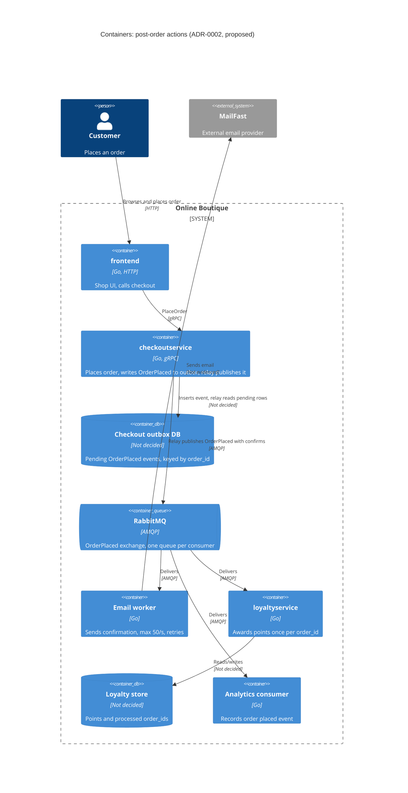

# ADR-0002: Publish an "order placed" event to RabbitMQ for post-order actions

- **Status:** Proposed
- **Date:** 2026-10-25
- **Deciders:** ทีมพัฒนา Online Boutique (4 developers ตาม `docs/scenario.md`); รายชื่อผู้ตัดสินใจยังไม่ระบุ (ดู Open questions)

## Context and problem

Requirement R-12 (`docs/scenario.md`) กำหนดว่าหลังจากสั่งซื้อสำเร็จ ระบบต้อง (1) ส่งอีเมลยืนยันผ่าน **MailFast** แทน `emailservice` แบบ mock, (2) ให้ **loyalty points** ผ่าน `loyaltyservice` ตัวใหม่ และ (3) บันทึก analytics event "order placed" ให้ทีม marketing ปีหน้าจะมี post-order action เพิ่มอีก (SMS, fraud scoring, recommendations update)

**การทำงานปัจจุบัน (evidence):**

| ข้อเท็จจริง                                                                                                                                    | หลักฐาน                                                                            |
| ---------------------------------------------------------------------------------------------------------------------------------------------- | ---------------------------------------------------------------------------------- |
| `PlaceOrder` เรียก `chargeCard` (payment) → `shipOrder` (shipping) → `emptyUserCart` → `sendOrderConfirmation` (email) ทีละขั้นแบบ synchronous | `system/online-boutique/src/checkoutservice/main.go` (`PlaceOrder`, lines 252–277) |
| ทุก dependency เป็น gRPC client connection ที่ตั้งค่าจาก env var                                                                               | `main.go` (`mustMapEnv`, `mustConnGRPC`, lines 111–123; `EMAIL_SERVICE_ADDR`)      |
| ถ้าส่งอีเมลล้มเหลว จะแค่ `log.Warnf` และ order ยังสำเร็จ                                                                                       | `main.go` lines 273–275                                                            |
| `orderID` สร้างด้วย `uuid.NewUUID()` ก่อนเริ่มทำงาน ใช้เป็น idempotency key ได้                                                                | `main.go` line 233                                                                 |
| `checkoutservice` ไม่มี database ของตัวเอง                                                                                                     | `main.go` (struct `checkoutService` มีแค่ gRPC connections, lines 66–86)           |

**ตัวเลขที่สำคัญ (`docs/scenario.md`):**

- p95 ของ `PlaceOrder` ต้อง **≤ 500 ms** (ปัจจุบันประมาณ 300 ms) → เหลือ budget ประมาณ **200 ms**
- MailFast: p95 **1.5 s**, p99 **8 s**, fail ประมาณ **0.5 %**, rate limit **50 emails/s**
- Peak **200 orders/s** (11.11) → สูงกว่า rate limit ของ MailFast **4 เท่า**; backlog โตประมาณ 150 emails/s (ประมาณ 9,000 emails ต่อนาทีของ peak)
- Loyalty points: ภายใน **1 นาที** และ **exactly once**
- Order ต้อง **ไม่ล้มเหลว** เพราะ email, loyalty หรือ analytics ล่ม

**ปัญหา:** จะเชื่อม `checkoutservice` กับ post-order action ทั้งสาม (และที่จะเพิ่มในอนาคต) อย่างไร โดยไม่ทำให้ latency เกิน, ไม่ทำให้ order ล้มเหลว, เคารพ rate limit ของ MailFast และให้ loyalty points ถูกต้องแบบ exactly once

## Decision drivers

1. **Availability:** order ต้องไม่ล้มเหลวเพราะ email / loyalty / analytics ล่ม
2. **Performance:** p95 `PlaceOrder` ≤ 500 ms ที่ 200 orders/s; MailFast p95 1.5 s อย่างเดียวก็เกิน budget แล้ว
3. **Correctness (reliability):** loyalty points ภายใน 1 นาที และไม่ให้ซ้ำ
4. **Throughput / external constraint:** ส่งอีเมลได้ไม่เกิน 50 emails/s ขณะที่ order เข้า 200/s
5. **Modifiability:** เพิ่ม post-order action ใหม่ (SMS, fraud scoring, recommendations) ได้โดยไม่ต้องแก้ `checkoutservice` ทุกครั้ง
6. **Operability และ team fit:** รันบน Kubernetes, ชอบ open-source self-hosted, ทีม 4 คนเก่ง Go/gRPC, 2 คนเคยใช้ RabbitMQ

## Considered options

1. **Synchronous gRPC fan-out:** ขยาย `PlaceOrder` ให้เรียก MailFast adapter, `loyaltyservice` และ analytics ตามลำดับ เหมือน `sendOrderConfirmation` ในปัจจุบัน
2. **In-process async (goroutines):** `PlaceOrder` ตอบลูกค้าก่อน แล้วยิง action ทั้งหมดใน goroutine พื้นหลังภายใน `checkoutservice`
3. **Message broker (RabbitMQ, self-hosted):** `checkoutservice` publish event `OrderPlaced` หนึ่งครั้ง ไปยัง exchange; แต่ละ consumer (email worker → MailFast, `loyaltyservice`, analytics) มี queue ของตัวเอง
4. **Event log (Apache Kafka, self-hosted):** แบบเดียวกับข้อ 3 แต่ใช้ Kafka topic และ consumer groups

### Pros and cons of the options

| Option        | Pros                                                                                                                                                                                                                                                                                          | Cons                                                                                                                                                                                                                    |
| ------------- | --------------------------------------------------------------------------------------------------------------------------------------------------------------------------------------------------------------------------------------------------------------------------------------------- | ----------------------------------------------------------------------------------------------------------------------------------------------------------------------------------------------------------------------- |
| 1. Sync gRPC  | ง่ายที่สุด; ตรงกับ pattern เดิมใน `main.go`; ไม่มี component ใหม่                                                                                                                                                                                                                             | MailFast p95 1.5 s / p99 8 s ทำให้ p95 > 500 ms แน่นอน; 200 orders/s ชน rate limit 50/s; ทุก action ใหม่ต้องแก้และ deploy `checkoutservice`; coupling สูง                                                               |
| 2. Goroutines | Latency ต่ำ (ไม่รอ action); ไม่มี infrastructure ใหม่                                                                                                                                                                                                                                         | งานหายถ้า pod restart/crash (ไม่มี durable store, `main.go` ไม่มี DB) → ไม่รับประกัน loyalty; ไม่มี backpressure สำหรับ rate limit 50/s; retry/idempotency ต้องเขียนเอง; ยังต้องแก้ `checkoutservice` เมื่อเพิ่ม action |
| 3. RabbitMQ   | Decouple ทั้ง latency และ availability; queue แยกต่อ consumer → email backlog ไม่ถ่วง loyalty; consumer จำกัด rate ไปที่ MailFast ได้ (prefetch + rate limiter); มี retry / dead-letter queue; เพิ่ม action ใหม่ = เพิ่ม queue + consumer; open-source, รันบน Kubernetes ได้; 2 คนในทีมเคยใช้ | Component ใหม่ที่ต้อง operate (HA, monitoring); delivery เป็น at-least-once → consumer ต้อง idempotent; ถ้า broker ล่มตอน publish ต้องมีกลไกกันไม่ให้ event หาย; eventual consistency                                   |
| 4. Kafka      | Throughput สูง; เก็บ event ไว้ replay ได้ (ดีกับ analytics / recommendations); เพิ่ม consumer group ได้ง่าย                                                                                                                                                                                   | Operate หนักกว่าสำหรับทีม 4 คน; ไม่มีใครในทีมเคยใช้ (`docs/scenario.md`); 200 events/s ไม่ต้องการ throughput ระดับนี้; rate limiting ต่อ consumer และ dead-letter ต้องทำเองมากกว่า                                      |

## Decision

เลือก **Option 3: RabbitMQ (self-hosted บน Kubernetes)**

- หลัง `shipOrder` สำเร็จ `checkoutservice` จะสร้าง event `OrderPlaced` (มี `order_id`, email, items, totals) **หนึ่งครั้ง** แทนการเรียก `sendOrderConfirmation` แบบ synchronous (`main.go` lines 273–277)
- **Transactional outbox:** เพิ่ม database ใหม่ให้ `checkoutservice` (ปัจจุบันไม่มี database เลย, `main.go` lines 66–86)
  - `PlaceOrder` insert event ลงตาราง `outbox` (primary key = `order_id`) ก่อนตอบลูกค้า: เป็น local write ครั้งเดียว ไม่ต้องรอ broker
  - **Outbox relay** (background goroutine ใน `checkoutservice`) อ่าน row ที่ยังไม่ publish → publish ไปยัง RabbitMQ exchange พร้อม publisher confirms → mark ว่า published เมื่อได้ confirm
  - ถ้า broker ล่ม event ยังอยู่ใน outbox และ relay retry จนสำเร็จ → event ไม่หาย, delivery เป็น at-least-once
  - ถ้า insert ลง outbox ล้มเหลว: retry สั้นๆ ภายใน latency budget; ถ้ายังไม่ได้ order ยังสำเร็จ แต่ log error + alert เพื่อชดเชยแต้มด้วยมือ (residual risk, ดู Risks)
  - Database technology: ยังไม่ตัดสิน (ดู Open questions)
- Consumer แยก queue:
  - **email worker** → MailFast: จำกัดไม่เกิน 50 emails/s, retry + dead-letter queue สำหรับ 0.5 % ที่ fail
  - **`loyaltyservice`**: idempotent โดยใช้ `order_id` เป็น unique key ก่อนบวกแต้ม → at-least-once delivery + idempotent consumer = ผลลัพธ์ exactly once
  - **analytics consumer**: บันทึก event ให้ marketing
- Action ในอนาคต (SMS, fraud scoring, recommendations) = bind queue ใหม่เข้ากับ exchange เดิม ไม่ต้องแก้ `checkoutservice`

เหตุผล: RabbitMQ ร่วมกับ outbox เป็นตัวเลือกเดียวที่ตอบ driver 1–5 ได้พร้อมกัน และเหมาะกับทีม (driver 6) มากกว่า Kafka. Outbox ปิดช่องว่างของ driver 3: ถ้าไม่มี outbox, event ที่ publish ไม่สำเร็จจะหาย และ loyalty จะเป็น at-most-once. Option 1 ผิดข้อกำหนด latency และ rate limit โดยตรง; Option 2 ไม่ durable จึงรับประกัน loyalty ไม่ได้

## Consequences

- **Positive:** latency ของ MailFast (p95 1.5 s, p99 8 s) ออกไปจาก critical path; `PlaceOrder` เพิ่มแค่ local insert ลง outbox หนึ่งครั้ง (ไม่รอ broker) (quality attribute: performance)
- **Positive:** event ไม่หายแม้ broker ล่ม เพราะอยู่ใน outbox จน relay publish สำเร็จ → loyalty ได้แต้มครบ (quality attribute: reliability / correctness)
- **Positive:** email / loyalty / analytics ล่มไม่กระทบ order; message รออยู่ใน queue จน consumer กลับมา (quality attribute: availability)
- **Positive:** queue ดูดซับ peak 200 orders/s ขณะที่ email worker ส่งที่ 50/s; loyalty มี queue ของตัวเองจึงไม่ติด backlog ของอีเมล (quality attribute: scalability / throughput)
- **Positive:** เพิ่ม post-order action ใหม่โดยไม่แก้ `checkoutservice` (quality attribute: modifiability)
- **Positive:** idempotent `loyaltyservice` บน `order_id` ป้องกันแต้มซ้ำ (quality attribute: reliability / correctness)
- **Negative:** อีเมลยืนยันอาจช้าไปหลายนาทีช่วง peak: backlog ประมาณ 9,000 emails ต่อนาทีของ peak ต้องใช้เวลาประมาณ 3 นาทีในการระบายต่อหนึ่งนาทีของ peak (quality attribute: user-perceived timeliness)
- **Negative:** มี stateful component ใหม่ **สองตัว** (RabbitMQ และ outbox database) ที่ต้อง operate, monitor, backup และ upgrade; `checkoutservice` ซึ่งเดิมเป็น stateless จะมี state (quality attribute: operability / cost)
- **Negative:** outbox database อยู่บน critical path ของ `PlaceOrder`: ถ้า database ช้าหรือล่ม จะกระทบ latency และต้องใช้ fallback (log + alert) (quality attribute: performance / availability)
- **Negative:** eventual consistency; debug flow ข้าม async boundary ยากขึ้น ต้องส่ง trace context (OpenTelemetry มีอยู่แล้วใน `main.go` lines 134–140) ไปใน message header (quality attribute: observability)
- **Risks and mitigations:**
  - _Broker ล่มตอน publish → event หาย (loyalty ไม่ได้)_: แก้ด้วย transactional outbox + publisher confirms; relay retry จนสำเร็จ
  - _Insert ลง outbox ล้มเหลวหลัง charge สำเร็จแล้ว_: payment และ shipping เป็น remote call จึงอยู่ใน transaction เดียวกับ outbox ไม่ได้ → retry สั้นๆ แล้ว log error + alert เพื่อชดเชยแต้ม; รัน database แบบ HA เพื่อลดโอกาส (residual risk)
  - _Relay publish ซ้ำ (crash หลัง publish แต่ก่อน mark)_: ยอมรับได้ เพราะ consumer idempotent บน `order_id` อยู่แล้ว
  - _Outbox table โตไม่หยุด_: ลบ row ที่ published แล้วเป็นระยะ
  - _Broker เป็น single point of failure ของ post-order flow_: รัน RabbitMQ แบบ cluster ด้วย quorum queues บน Kubernetes
  - _Message ซ้ำ (at-least-once)_: consumer ทุกตัวต้อง idempotent บน `order_id`; email ซ้ำอาจเกิดได้ถ้าไม่เก็บ dedup
  - _MailFast fail 0.5 % / timeout p99 8 s_: retry with backoff + dead-letter queue + alert
  - _Outbox insert ทำให้ latency เพิ่ม_: ตั้ง timeout ของ insert ให้อยู่ใน budget 200 ms **[Inferred]** local insert ครั้งเดียวน่าจะใช้เวลาไม่กี่ ms แต่ไม่มีตัวเลขในไฟล์ที่ให้มา ต้องวัด

## Validation

- **Load test** ที่ 200 orders/s (เช่นใช้ Locust `loadgenerator`): p95 `PlaceOrder` ≤ 500 ms ขณะ publish event
- **Fault injection:** ปิด email worker, `loyaltyservice`, analytics consumer และ MailFast (ทีละตัว) ระหว่าง load test → order success rate ต้องไม่ลดลง
- **Loyalty metric:** วัดเวลา order → แต้มเข้า; p100 ภายใน 1 นาทีที่ peak; นับจำนวน `order_id` ที่ได้แต้มมากกว่า 1 ครั้ง = 0 (ทดสอบโดยส่ง message ซ้ำโดยตั้งใจ)
- **Broker failure test:** ระหว่าง load test ที่ 200 orders/s ให้ kill RabbitMQ (ทุก node) ช่วงหนึ่งแล้วเปิดกลับ → order success rate ต้องไม่ลดลง; หลัง relay ระบาย outbox หมดแล้ว นับ order ที่สำเร็จแต่**ไม่มี loyalty points** ต้อง = 0 (เทียบ `order_id` ใน outbox กับ loyalty store); วัดเวลาที่ relay ใช้ระบาย outbox หลัง broker กลับมา
- **Email metric:** อัตราส่งไป MailFast ไม่เกิน 50/s; queue depth และเวลาระบาย backlog หลัง peak; จำนวนใน dead-letter queue
- **Review date:** ทบทวนหลังการขาย 11.11 ครั้งแรก หรือก่อนเพิ่ม post-order action ตัวแรกของปีหน้า

## Open questions

- **ยอมให้อีเมลยืนยันล่าช้าได้นานเท่าไร?** ไม่ระบุใน `docs/scenario.md`; ที่ 200 orders/s กับ 50 emails/s backlog จะโตตลอดช่วง peak ต้องรู้ระยะเวลาของ peak 11.11 ด้วย (ไม่ระบุ)
- **ขอเพิ่ม rate limit ของ MailFast ได้ไหม** หรือมี batch API ไหม? ไม่ระบุ
- **Protocol / API ของ MailFast** (HTTPS? SDK?) และ idempotency key สำหรับกันอีเมลซ้ำ: ไม่ระบุ
- **Outbox database ใช้ technology อะไร** (เช่น PostgreSQL หรือ database เดียวกับที่ `loyaltyservice` จะใช้) และ run แบบ HA อย่างไร: ยังไม่ตัดสิน (อาจเป็น ADR แยก)
- **`loyaltyservice` จะใช้ data store อะไร** เพื่อเก็บแต้มและ `order_id` ที่ประมวลผลแล้ว: ยังไม่ตัดสิน (อาจเป็น ADR แยก)
- **Analytics event ส่งไปที่ไหน** (ระบบ / data warehouse ของ marketing) และยอมให้หายได้บ้างไหม: ไม่ระบุ
- **Latency ของ outbox insert** และเวลาที่ relay ใช้ publish ไป RabbitMQ: ไม่มีตัวเลข ต้องวัด
- **ใครเป็น Deciders** และทีมมีความสามารถ operate RabbitMQ cluster แบบ HA ใน production ได้แค่ไหน (รู้แค่ว่า 2 คน "เคยใช้"): ไม่ระบุ
- **Fraud scoring ในอนาคต** อาจต้องการผลก่อนยืนยัน order (synchronous) ซึ่งไม่เข้ากับ event หลัง order: ต้องตัดสินใจแยกเมื่อมี requirement
