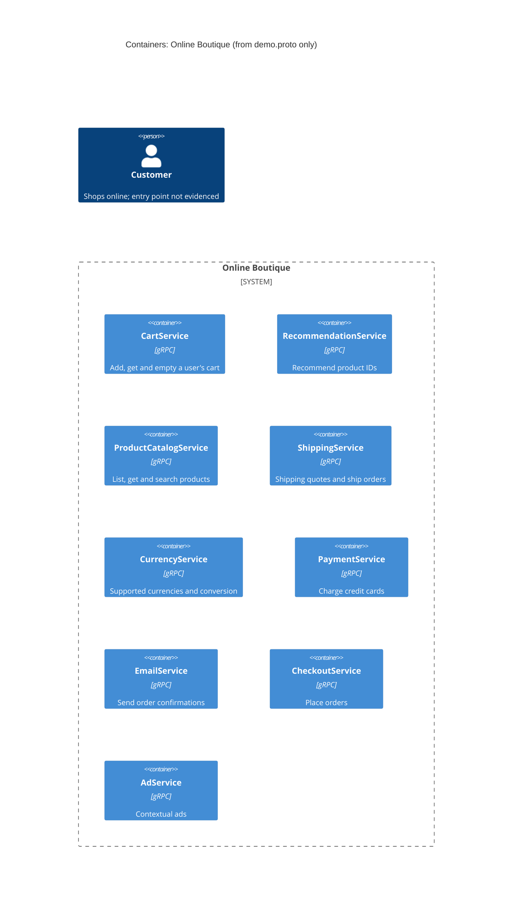

# Task 1A: Recovered architecture (C4 container level)

## 1. Agent

- Product: Claude Code (VS Code extension)
- Model: Claude Opus 5.5 (`claude-opus-5-5`)

## 2. Files read

- `prompts/1-recover-architecture.md` (task instructions)
- `system/online-boutique/protos/demo.proto` (the only evidence)

## 3. Containers table

The proto file defines service **interfaces** only. Container names below are the proto `service` names. The deployed service names, languages and data stores are not in this file.

| Container | Technology / language | Responsibility (from RPCs) | Evidence |
|---|---|---|---|
| CartService | gRPC interface (proto3); language not evidenced | Add items to a user's cart, get the cart, empty it (`AddItem`, `GetCart`, `EmptyCart`) | `system/online-boutique/protos/demo.proto` (`service CartService`, l.23–27) |
| RecommendationService | gRPC interface (proto3); language not evidenced | Recommend product IDs for a user and a list of products (`ListRecommendations`) | `system/online-boutique/protos/demo.proto` (`service RecommendationService`, l.56–58) |
| ProductCatalogService | gRPC interface (proto3); language not evidenced | List, get and search products (`ListProducts`, `GetProduct`, `SearchProducts`) | `system/online-boutique/protos/demo.proto` (`service ProductCatalogService`, l.71–75) |
| ShippingService | gRPC interface (proto3); language not evidenced | Quote shipping cost and ship an order, returning a tracking ID (`GetQuote`, `ShipOrder`) | `system/online-boutique/protos/demo.proto` (`service ShippingService`, l.107–110) |
| CurrencyService | gRPC interface (proto3); language not evidenced | List supported currencies and convert `Money` amounts (`GetSupportedCurrencies`, `Convert`) | `system/online-boutique/protos/demo.proto` (`service CurrencyService`, l.140–143) |
| PaymentService | gRPC interface (proto3); language not evidenced | Charge a credit card, returning a transaction ID (`Charge`) | `system/online-boutique/protos/demo.proto` (`service PaymentService`, l.177–179) |
| EmailService | gRPC interface (proto3); language not evidenced | Send an order confirmation to an email address (`SendOrderConfirmation`) | `system/online-boutique/protos/demo.proto` (`service EmailService`, l.199–201) |
| CheckoutService | gRPC interface (proto3); language not evidenced | Place an order from user ID, currency, address, email and card (`PlaceOrder`) | `system/online-boutique/protos/demo.proto` (`service CheckoutService`, l.224–226) |
| AdService | gRPC interface (proto3); language not evidenced | Return ads for a set of page context keys (`GetAds`) | `system/online-boutique/protos/demo.proto` (`service AdService`, l.243–245) |

Notes:
- Protocol: the file uses proto3 `service` / `rpc` definitions (l.15, l.23 ff.). Treating these as gRPC is the standard reading of proto3 services, but the transport itself is **[Inferred]**: no server or client code is in the evidence.
- Data stores: **none evidenced**. No database, cache or message broker appears in the proto.
- Frontend / UI: **not evidenced**. No `service` for a web frontend is defined.

## 4. Dependencies table

| Caller → callee | Protocol | Evidence |
|---|---|---|
| *(none)* | — | Not evidenced in the provided files. `demo.proto` declares what each service offers, not who calls it. |

Inferred dependencies (not proven, so not in the diagram) are listed under **Gaps**.

## 5. Mermaid diagram

The diagram matches the tables: 9 containers, no evidenced dependencies, so no `Rel`. The end user is shown as required, but how they reach the system is not evidenced (see Gaps).

## 6. Gaps

| Gap | What the proto suggests | File that would settle it |
|---|---|---|
| Who calls whom (all runtime dependencies) | **[Inferred]** `CheckoutService` orchestrates an order: `PlaceOrderRequest` carries `CreditCardInfo` (→ PaymentService), `Address` (→ ShippingService), `email` (→ EmailService), `user_currency` (→ CurrencyService), `user_id` (→ CartService); `OrderResult` holds `shipping_tracking_id` and `shipping_cost` (l.208–214, 228–235) | Kubernetes manifests with service address environment variables (e.g. `system/online-boutique/kubernetes-manifests/checkoutservice.yaml`); checkout service source code |
| Customer entry point / web frontend | **[Inferred]** a UI that calls Cart, Catalog, Recommendation, Ad, Currency, Shipping and Checkout services; none is defined here | Frontend manifest (e.g. `system/online-boutique/kubernetes-manifests/frontend.yaml`) and frontend source |
| RecommendationService → ProductCatalogService | **[Inferred]** it returns only product IDs and may need the catalog to pick them | Recommendation service source / manifest |
| Data stores (e.g. where carts are kept) | Not evidenced | Cart service manifest and source; any database/cache manifests |
| Implementation language of each service | Not evidenced (`go_package`, l.19, only says Go stubs are generated, not which services use them) | Each service's source folder / Dockerfile under `system/online-boutique/src/` |
| External systems (real payment provider, email server) | Not evidenced | Payment and email service source code |
| Deployment, ports, replicas | Not evidenced | `system/online-boutique/kubernetes-manifests/` |
