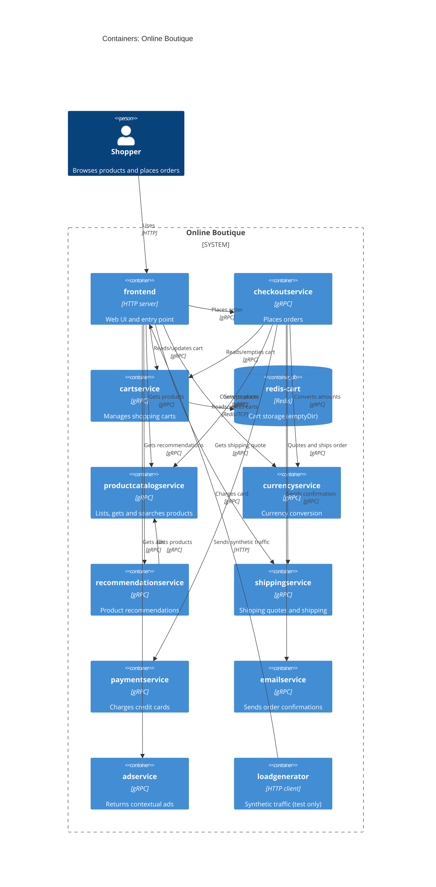

# 1B — Recovered C4 container architecture: Online Boutique

## 1. Agent

Claude Code (Anthropic), model Claude Opus 5.5 (`claude-opus-5-5`).

## 2. Files read

- `prompts/1-recover-architecture.md` (task file)
- `system/online-boutique/protos/demo.proto`
- `system/online-boutique/kubernetes-manifests/README.md`
- `system/online-boutique/kubernetes-manifests/kustomization.yaml`
- `system/online-boutique/kubernetes-manifests/adservice.yaml`
- `system/online-boutique/kubernetes-manifests/cartservice.yaml`
- `system/online-boutique/kubernetes-manifests/checkoutservice.yaml`
- `system/online-boutique/kubernetes-manifests/currencyservice.yaml`
- `system/online-boutique/kubernetes-manifests/emailservice.yaml`
- `system/online-boutique/kubernetes-manifests/frontend.yaml`
- `system/online-boutique/kubernetes-manifests/loadgenerator.yaml`
- `system/online-boutique/kubernetes-manifests/paymentservice.yaml`
- `system/online-boutique/kubernetes-manifests/productcatalogservice.yaml`
- `system/online-boutique/kubernetes-manifests/recommendationservice.yaml`
- `system/online-boutique/kubernetes-manifests/shippingservice.yaml`

## 3. Containers table

Implementation language is **not evidenced** for any service: the manifests use bare image names (e.g. `image: frontend`) and the proto file says nothing about languages. "Technology" below is therefore the interface technology the evidence shows.

| Container | Technology / language | Responsibility | Evidence |
|---|---|---|---|
| `frontend` | HTTP server on port 8080 (`/_healthz` probe); exposed via `LoadBalancer` service `frontend-external`; language not evidenced | Web UI / entry point for shoppers; calls all back-end services | `kubernetes-manifests/frontend.yaml` (Deployment `frontend`, Service `frontend-external` type `LoadBalancer`, port name `http`) |
| `cartservice` | gRPC server on 7070 (gRPC probes, port name `grpc`); language not evidenced | Add items, get cart, empty cart | `kubernetes-manifests/cartservice.yaml`; `protos/demo.proto` (`service CartService`: `AddItem`, `GetCart`, `EmptyCart`) |
| `redis-cart` (ContainerDb) | Redis (`image: redis:alpine`), port 6379; storage is `emptyDir` (not persistent across pod restarts) | Stores cart data for `cartservice` | `kubernetes-manifests/cartservice.yaml` (Deployment `redis-cart`, volume `redis-data: emptyDir`) |
| `productcatalogservice` | gRPC server on 3550; language not evidenced | List, get and search products | `kubernetes-manifests/productcatalogservice.yaml`; `protos/demo.proto` (`service ProductCatalogService`) |
| `currencyservice` | gRPC server on 7000; language not evidenced | List supported currencies, convert `Money` | `kubernetes-manifests/currencyservice.yaml`; `protos/demo.proto` (`service CurrencyService`: `GetSupportedCurrencies`, `Convert`) |
| `recommendationservice` | gRPC server on 8080; language not evidenced | Recommend product IDs | `kubernetes-manifests/recommendationservice.yaml`; `protos/demo.proto` (`service RecommendationService`: `ListRecommendations`) |
| `shippingservice` | gRPC server on 50051; language not evidenced | Shipping quotes and ship orders (returns `tracking_id`) | `kubernetes-manifests/shippingservice.yaml`; `protos/demo.proto` (`service ShippingService`: `GetQuote`, `ShipOrder`) |
| `checkoutservice` | gRPC server on 5050; language not evidenced | Places an order (orchestrates the checkout) | `kubernetes-manifests/checkoutservice.yaml`; `protos/demo.proto` (`service CheckoutService`: `PlaceOrder`) |
| `paymentservice` | gRPC server on 50051; language not evidenced | Charges a credit card, returns `transaction_id` | `kubernetes-manifests/paymentservice.yaml`; `protos/demo.proto` (`service PaymentService`: `Charge`) |
| `emailservice` | gRPC server (Service port 5000 → container 8080); language not evidenced | Sends order confirmation | `kubernetes-manifests/emailservice.yaml`; `protos/demo.proto` (`service EmailService`: `SendOrderConfirmation`) |
| `adservice` | gRPC server on 9555; language not evidenced | Returns context-based ads | `kubernetes-manifests/adservice.yaml`; `protos/demo.proto` (`service AdService`: `GetAds`) |
| `loadgenerator` | Container with HTTP client (init container uses `wget http://${FRONTEND_ADDR}`); language not evidenced | Generates synthetic user traffic (`USERS=10`, `RATE=1`). Not in the default kustomization (`# - loadgenerator.yaml`), so it is a test tool, not part of the production shop | `kubernetes-manifests/loadgenerator.yaml`; `kubernetes-manifests/kustomization.yaml` (commented-out entry) |

## 4. Dependencies table

Protocol for service→service calls is gRPC: the callee's Kubernetes Service port is named `grpc`, its probes are `grpc`, and its API is a `service` in `demo.proto`. The env variables show only `host:port`, not the protocol itself.

| Caller → callee | Protocol | Evidence |
|---|---|---|
| Shopper → `frontend` | HTTP (port 80 → 8080) | `frontend.yaml` (Service `frontend-external`, `type: LoadBalancer`, port name `http`) |
| `loadgenerator` → `frontend` | HTTP | `loadgenerator.yaml` (`FRONTEND_ADDR=frontend:80`; `wget http://${FRONTEND_ADDR}`) |
| `frontend` → `productcatalogservice` | gRPC | `frontend.yaml` (`PRODUCT_CATALOG_SERVICE_ADDR=productcatalogservice:3550`) |
| `frontend` → `currencyservice` | gRPC | `frontend.yaml` (`CURRENCY_SERVICE_ADDR=currencyservice:7000`) |
| `frontend` → `cartservice` | gRPC | `frontend.yaml` (`CART_SERVICE_ADDR=cartservice:7070`) |
| `frontend` → `recommendationservice` | gRPC | `frontend.yaml` (`RECOMMENDATION_SERVICE_ADDR=recommendationservice:8080`) |
| `frontend` → `shippingservice` | gRPC | `frontend.yaml` (`SHIPPING_SERVICE_ADDR=shippingservice:50051`) |
| `frontend` → `checkoutservice` | gRPC | `frontend.yaml` (`CHECKOUT_SERVICE_ADDR=checkoutservice:5050`) |
| `frontend` → `adservice` | gRPC | `frontend.yaml` (`AD_SERVICE_ADDR=adservice:9555`) |
| `checkoutservice` → `productcatalogservice` | gRPC | `checkoutservice.yaml` (`PRODUCT_CATALOG_SERVICE_ADDR=productcatalogservice:3550`) |
| `checkoutservice` → `shippingservice` | gRPC | `checkoutservice.yaml` (`SHIPPING_SERVICE_ADDR=shippingservice:50051`) |
| `checkoutservice` → `paymentservice` | gRPC | `checkoutservice.yaml` (`PAYMENT_SERVICE_ADDR=paymentservice:50051`) |
| `checkoutservice` → `emailservice` | gRPC | `checkoutservice.yaml` (`EMAIL_SERVICE_ADDR=emailservice:5000`) |
| `checkoutservice` → `currencyservice` | gRPC | `checkoutservice.yaml` (`CURRENCY_SERVICE_ADDR=currencyservice:7000`) |
| `checkoutservice` → `cartservice` | gRPC | `checkoutservice.yaml` (`CART_SERVICE_ADDR=cartservice:7070`) |
| `recommendationservice` → `productcatalogservice` | gRPC | `recommendationservice.yaml` (`PRODUCT_CATALOG_SERVICE_ADDR=productcatalogservice:3550`) |
| `cartservice` → `redis-cart` | Redis protocol over TCP (port 6379) | `cartservice.yaml` (`REDIS_ADDR=redis-cart:6379`; Service `redis-cart` port name `tcp-redis`) |

`currencyservice`, `paymentservice`, `shippingservice`, `emailservice`, `adservice` and `productcatalogservice` have no `*_ADDR` env variables, so no outgoing dependencies are evidenced for them.

## 5. Mermaid diagram

Relationship labels (e.g. "Charges card") come from the callee's RPC names in `demo.proto`. Which RPC each caller actually invokes is **[Inferred]**; only the connection itself is evidenced.

## 6. Gaps

| Gap | What would settle it |
|---|---|
| Implementation language of every service | Each service's source folder or `Dockerfile` (e.g. `system/online-boutique/src/<service>/Dockerfile`) |
| `shoppingassistantservice`: `frontend.yaml` sets `SHOPPING_ASSISTANT_SERVICE_ADDR=shoppingassistantservice:80`, but there is no manifest for it in the evidence, and `ENABLE_ASSISTANT` is commented out. Left out of the diagram | `kustomize/components/shopping-assistant/` and the frontend source |
| Optional "packaging service" (`PACKAGING_SERVICE_URL`, commented out in `frontend.yaml`). Left out | Frontend source; the Google Cloud demo docs |
| Optional data stores/integrations listed only as commented-out kustomize components (`memorystore`, `alloydb`, `spanner`, `google-cloud-operations`). Left out | `system/online-boutique/kustomize/components/*` |
| Which RPCs each caller uses (e.g. does `frontend` call `ShippingService.GetQuote` only?) | Client code in `frontend` and `checkoutservice` source |
| Whether `paymentservice` calls a real payment provider, or `emailservice` a real mail server (SMTP). No such dependency is in the evidence, so no `System_Ext` is drawn | `src/paymentservice/` and `src/emailservice/` source |
| Whether `productcatalogservice` and `adservice` have their own data store (no store or env var is evidenced) | Their source code |
| Whether the frontend serves HTTPS anywhere (only HTTP on port 80 is evidenced) | Ingress / Istio manifests, if any |
| Sync vs. async: no message broker appears in the evidence; all evidenced calls are request/response gRPC | Service source code |
